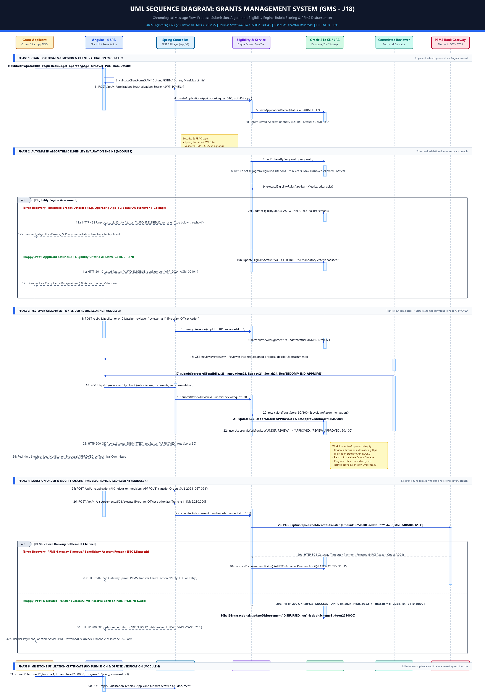
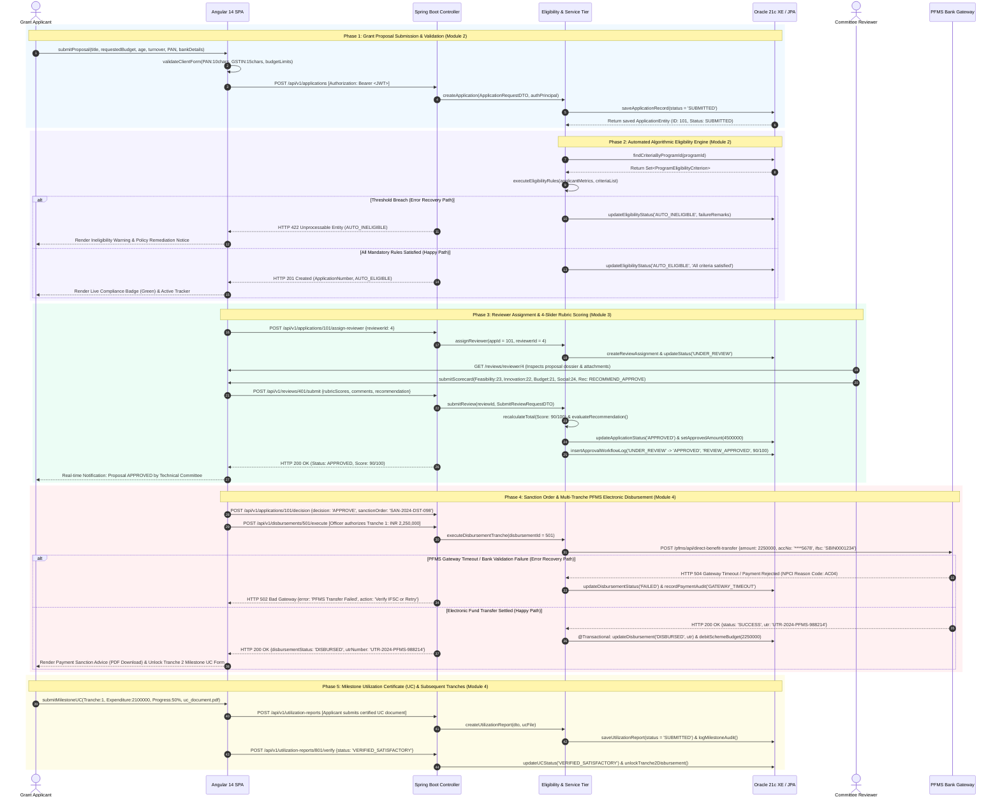

# Grants Management System (GMS) | Project Technical Dossier
### Project Code: J18 | Government & Public Sector Domain
**Academic Institution**: ABES Engineering College, Ghaziabad  
**Degree / Department**: Master of Computer Applications (MCA 2026 – 2027)  
**Student Developer**: **Devansh Srivastava** | **University Roll No**: `2500320140048`  
**Project Guide / Supervisor**: **Ms. Charshini Bandreddi**, Assistant Professor, MCA  
**Skill Track**: FSD Java (HCLTech EdTech Career Shaper Capstone)  
**GitHub Repository**: [https://github.com/arun-ranaa/HCLTech-Career-Shaper..git](https://github.com/arun-ranaa/HCLTech-Career-Shaper..git)  

---

## 1. Executive Summary & Problem Statement

In public sector grant governance (e.g., Department of Science & Technology, Ministry of MSME, Ministry of Agriculture), traditional grant administration is plagued by manual paper-based submissions, opaque eligibility evaluations, protracted peer review turnaround times, and disconnected financial reconciliation of multi-tranche disbursements.

The **Grants Management System (GMS)** solves these operational bottlenecks by providing an end-to-end, role-governed digital lifecycle:
1. **Grant Program Setup & Budgeting**: Ministry Program Officers design schemes with defined budget ceilings, application date windows, and automated parametric eligibility rules.
2. **Application Submission & Automated Eligibility Verification**: Citizen, startup, and NGO applicants self-register, submit proposals, and receive real-time algorithmic eligibility evaluation.
3. **Peer Review & Committee Workflow**: Domain experts evaluate proposals using a standardized 4-slider rubric scorecard (0–100 scale), automatically updating the application status to `APPROVED` upon recommendation and enabling formal Sanction Orders.
4. **PFMS Multi-Tranche Disbursement & Milestone Tracking**: Funds are disbursed in milestones simulating the Public Financial Management System (PFMS) with Unique Transaction Reference (UTR) numbers, strictly linked to verified Utilization Certificates (UCs).

---

## 2. Technology Stack Architecture

| Layer / Component | Technology Selected | Version / Specification | Role in Architecture |
| :--- | :--- | :--- | :--- |
| **Backend Runtime** | Java Development Kit (JDK) | **Java 17 LTS** | High-performance, modern object-oriented backend foundation. |
| **Backend Framework** | Spring Boot | **3.2.3** | Standalone production-grade REST microservice container. |
| **REST API Engine** | Spring MVC | **Spring Boot 3.x** | Exposes stateless, JSON-serialized endpoints under `/api/v1/*`. |
| **Persistence / ORM** | Spring Data JPA / Hibernate | **Hibernate 6.4.x** | Object-Relational Mapping, entity lifecycle, and transactional boundary management. |
| **Security & Auth** | Spring Security 6 & JJWT | **JJWT 0.12.5** | Stateless JWT authentication (HS256), BCrypt password hashing (cost 10), and `@PreAuthorize` role guards. |
| **Database Engine** | Oracle Database 21c XE / H2 | **Oracle 21c XE / H2 In-Memory** | Normalized Third Normal Form (3NF) relational database with ACID transactional integrity. |
| **Frontend Framework** | Angular 14 Architecture | **Angular 14 / ES6+ SPA** | Zero-dependency responsive client application structured into 4 role-isolated portals. |
| **Client UI & Styling** | CSS3 / Custom Design System | **Custom Responsive CSS** | Government of India corporate design language (Ashoka blue palette, accessible cards, modals, rubric sliders). |
| **Build & Dependency Tool** | Apache Maven | **Maven 3.9+** | Manages backend dependencies, build lifecycle, packaging, and JUnit test execution. |
| **Testing Framework** | JUnit 5 & Mockito | **Jupiter 5.10.2** | Automated unit and integration testing of the eligibility engine, business rules, and controllers. |
| **Version Control** | Git & GitHub | **Git 2.40+** | Agile feature branch workflow (`main`, `develop`), conventional commits, and sprint release tags (`v0.1.0` to `v1.0.0`). |

---

## 3. Four Core Modules & Functional Capabilities

```
+----------------------------------------------------------------------------------------------------+
|                                  GRANTS MANAGEMENT SYSTEM (J18)                                    |
+---------------------------------+----------------------------------+-------------------------------+
|  MODULE 1: PROGRAM CONFIG       |  MODULE 2: APPLICATION & ELIG    |  MODULE 3: REVIEW & SANCTION  |
|  • Scheme Setup & Budgeting     |  • Applicant Self-Registration   |  • Reviewer Assignment        |
|  • Parametric Eligibility Rules |  • Proposal Submission Wizard    |  • 4-Slider Rubric (0-100)    |
|  • State Machine (DRAFT->ACTIVE)|  • Algorithmic Eligibility Engine|  • Auto-Approval Transition   |
|  • Upload Checklists            |  • Real-Time Status Tracking     |  • Sanction Order Generation  |
+---------------------------------+----------------------------------+-------------------------------+
                                                  │
                                                  ▼
+----------------------------------------------------------------------------------------------------+
|                                 MODULE 4: DISBURSEMENT & REPORTING                                 |
|  • Multi-Tranche Disbursement Scheduling        • PFMS Electronic Fund Release & UTR Tracking       |
|  • Milestone Utilization Certificate (UC) Upload • Program Officer UC Verification & Audit Trail    |
|  • Executive Macro Analytics Dashboard           • Append-Only Immutable Security Logging          |
+----------------------------------------------------------------------------------------------------+
```

### Module 1: Grant Program Setup and Configuration
- **Program Creation**: Program Officers configure schemes with Program Code, Title, Category (`INNOVATION`, `AGRICULTURE`, `HEALTHCARE`, `WOMEN_ENTREPRENEURSHIP`), Total Allocated Budget, Grant Range (Min/Max Amount), and Active Application Horizons.
- **Parametric Eligibility Rules**: Dynamic criteria attached to schemes (Numeric thresholds, operator `GREATER_THAN_EQUAL`/`LESS_THAN_EQUAL`, mandatory flags, weightage).
- **Lifecycle Governance**: Strict state transitions: `DRAFT` ➔ `ACTIVE` ➔ `UNDER_EVALUATION` ➔ `CLOSED`.

### Module 2: Application Submission and Eligibility Check
- **Applicant Self-Registration**: Organization onboarding with verified credentials, PAN (10 chars), GSTIN (15 chars), entity type (`STARTUP`, `NGO`, `ACADEMIC_INSTITUTE`, `ENTERPRISE`), and salted BCrypt credentials.
- **Proposal Submission Form**: Capture of project title, executive summary, requested funding, timeline, operating age, annual turnover, target beneficiaries, and bank details.
- **Automated Algorithmic Eligibility Engine**: Instant validation comparing applicant metrics against scheme criteria. Automatically assigns `AUTO_ELIGIBLE` or `AUTO_INELIGIBLE` with audit failure reasons.

### Module 3: Review and Approval Workflow
- **Reviewer Assignment**: Program Officer delegates proposals to accredited technical evaluators from the committee panel.
- **4-Dimensional Rubric Scorecard**:
  1. *Technical Feasibility* (0 – 25 points)
  2. *Technological Innovation & Novelty* (0 – 25 points)
  3. *Budget Realism & Financial Viability* (0 – 25 points)
  4. *Social & Economic Impact* (0 – 25 points)
  - **Automatic Record Updation**: Upon review submission, the application record updates immediately to **`APPROVED`** status, persists across sessions, and generates a detailed audit trail.
- **Sanction Order Generation**: Program Officer inspects evaluator scorecards and issues official sanction orders with Sanction Order Number and final approved capital.

### Module 4: Grant Disbursement and Reporting
- **Multi-Tranche Scheduling**: Division of sanctioned capital into milestone tranches (Tranche Number, Amount, Scheduled Date, Bank Account & IFSC).
- **PFMS Fund Execution**: Electronic fund release generating simulated PFMS Unique Transaction Reference (UTR) numbers and debiting program budget counters.
- **Milestone Utilization Certificates (UC)**: Grant recipients submit certified expenditure logs, completion percentages (0–100%), and audited UC documents before subsequent tranches are unlocked.
- **Executive Analytics Dashboard**: Real-time aggregation of Total Schemes, Sanctioned Capital, Disbursed Funds, Sectoral Allocations, and Stage Breakdown.

---

## 4. Normalized Database Architecture (3NF)

The database schema is normalized to **Third Normal Form (3NF)** on **Oracle Database 21c XE**, ensuring no transitive or partial dependencies.

### Database Tables Specification

```
+------------------+         1:M         +----------------------+
|      ROLES       | ------------------> |        USERS         |
+------------------+                     +----------------------+
                                                    | 1:M
                                                    | (Submits)
                                                    v
+------------------+         1:M         +----------------------+
|  GRANT_PROGRAMS  | ------------------> |     APPLICATIONS     |
+------------------+                     +----------------------+
         | 1:M                               | 1:M              | 1:M
         v                                   v                  v
+-----------------------+         +--------------------+  +--------------------+
|  ELIGIBILITY_CRITERIA |         | APPLICATION_REVIEWS|  | GRANT_DISBURSEMENTS|
+-----------------------+         +--------------------+  +--------------------+
                                                                    | 1:1
                                                                    v
                                                          +--------------------+
                                                          |UTILIZATION_REPORTS |
                                                          +--------------------+
```

#### 1. `ROLES` (System Security Master)
- `role_id` (NUMBER, PK): Primary key.
- `role_name` (VARCHAR2(50), UNIQUE, NOT NULL): `ROLE_ADMIN`, `ROLE_PROGRAM_OFFICER`, `ROLE_REVIEWER`, `ROLE_APPLICANT`.
- `description` (VARCHAR2(255)): Functional role definition.

#### 2. `USERS` (Stakeholder Accounts)
- `user_id` (NUMBER, PK): Primary key.
- `username` (VARCHAR2(50), UNIQUE, NOT NULL): Sign-in handle.
- `email` (VARCHAR2(100), UNIQUE, NOT NULL): Official email address.
- `password_hash` (VARCHAR2(255), NOT NULL): Salted BCrypt hash.
- `full_name` (VARCHAR2(100), NOT NULL): Official contact name.
- `role_id` (NUMBER, FK -> ROLES): Assigned security privilege.
- `organization_name` (VARCHAR2(150)): DPIIT Startup / Ministry / University / NGO name.
- `designation` (VARCHAR2(100)): Job title / Academic appointment.
- `phone_number` (VARCHAR2(20)): Contact phone number.
- `is_active` (CHAR(1), DEFAULT 'Y'): Account status flag.

#### 3. `GRANT_PROGRAMS` (Scheme Configuration Master)
- `program_id` (NUMBER, PK): Primary key.
- `program_code` (VARCHAR2(50), UNIQUE, NOT NULL): e.g. `DST-SEED-2026`.
- `title` (VARCHAR2(200), NOT NULL): Full scheme title.
- `category` (VARCHAR2(50), NOT NULL): Innovation, Agriculture, Healthcare, etc.
- `funding_agency` (VARCHAR2(150), NOT NULL): Sponsoring Ministry / Department.
- `total_budget` (NUMBER(15,2), NOT NULL): Allocated scheme corpus.
- `disbursed_budget` (NUMBER(15,2), DEFAULT 0): Cumulative capital released.
- `min_grant_amount` / `max_grant_amount` (NUMBER(15,2)): Valid proposal range.
- `start_date` / `end_date` (DATE): Active application window.
- `status` (VARCHAR2(30), DEFAULT 'DRAFT'): `DRAFT`, `ACTIVE`, `UNDER_EVALUATION`, `CLOSED`.

#### 4. `PROGRAM_ELIGIBILITY_CRITERIA` (Parametric Rule Set)
- `criterion_id` (NUMBER, PK): Primary key.
- `program_id` (NUMBER, FK -> GRANT_PROGRAMS): Parent scheme.
- `criterion_code` (VARCHAR2(50), NOT NULL): e.g. `MIN_OPERATING_YEARS`.
- `criterion_name` (VARCHAR2(100), NOT NULL): Human-readable rule title.
- `criterion_type` (VARCHAR2(50), NOT NULL): `NUMERIC_MIN`, `NUMERIC_MAX`, `ALLOWED_ENTITIES`, `MANDATORY_FLAG`.
- `expected_value` (VARCHAR2(255), NOT NULL): Threshold value (e.g., `2`, `100000000`, `STARTUP,NGO`).
- `is_mandatory` (CHAR(1), DEFAULT 'Y'): Failure causes automatic rejection.
- `weightage` (NUMBER(5,2)): Scoring weightage in evaluation.

#### 5. `APPLICATIONS` (Grant Proposal Transaction Core)
- `application_id` (NUMBER, PK): Primary key.
- `application_number` (VARCHAR2(50), UNIQUE, NOT NULL): Auto-generated reference (e.g. `APP-2024-AGRI-00101`).
- `program_id` (NUMBER, FK -> GRANT_PROGRAMS): Applied grant scheme.
- `applicant_id` (NUMBER, FK -> USERS): Submitting applicant user.
- `project_title` (VARCHAR2(255), NOT NULL): Title of proposal.
- `project_summary` (CLOB / VARCHAR2(4000)): Executive abstract.
- `requested_amount` (NUMBER(15,2), NOT NULL): Capital requested.
- `approved_amount` (NUMBER(15,2)): Sanctioned funding amount.
- `project_duration_months` (NUMBER(3)): Project execution timeframe.
- `organization_type` (VARCHAR2(50)): `Startup`, `MSME`, `NGO`, `Academic Institute`.
- `organization_pan` (VARCHAR2(10), NOT NULL): 10-digit PAN.
- `organization_gstin` (VARCHAR2(15)): 15-character GSTIN.
- `annual_turnover` (NUMBER(15,2)): Annual audited turnover.
- `years_in_operation` (NUMBER(3)): Operational age.
- `eligibility_status` (VARCHAR2(30)): `AUTO_ELIGIBLE`, `AUTO_INELIGIBLE`, `MANUAL_VERIFIED`.
- `eligibility_remarks` (VARCHAR2(1000)): Failure or compliance notes.
- `status` (VARCHAR2(30), DEFAULT 'SUBMITTED'): `SUBMITTED`, `UNDER_REVIEW`, `APPROVED`, `REJECTED`, `DISBURSED`.
- `submission_date` (TIMESTAMP, DEFAULT CURRENT_TIMESTAMP): Submission time.

#### 6. `APPLICATION_REVIEWS` (Evaluator Rubric Scorecard)
- `review_id` (NUMBER, PK): Primary key.
- `application_id` (NUMBER, FK -> APPLICATIONS): Evaluated proposal.
- `reviewer_id` (NUMBER, FK -> USERS): Assigned technical committee member.
- `feasibility_score` (NUMBER(3)): 0 to 25.
- `innovation_score` (NUMBER(3)): 0 to 25.
- `budget_realism_score` (NUMBER(3)): 0 to 25.
- `social_impact_score` (NUMBER(3)): 0 to 25.
- `total_score` (NUMBER(3)): Calculated sum (0 to 100).
- `recommendation` (VARCHAR2(50)): `RECOMMEND_APPROVE`, `NEEDS_REVISION`, `RECOMMEND_REJECT`.
- `review_comments` (VARCHAR2(2000)): Technical feedback.
- `status` (VARCHAR2(30)): `ASSIGNED`, `SUBMITTED`.
- `review_date` (TIMESTAMP): Appraisal timestamp.

#### 7. `GRANT_DISBURSEMENTS` (PFMS Electronic Fund Transfers)
- `disbursement_id` (NUMBER, PK): Primary key.
- `application_id` (NUMBER, FK -> APPLICATIONS): Sanctioned proposal.
- `disbursement_reference` (VARCHAR2(50), UNIQUE, NOT NULL): e.g. `PFMS-2024-TR1-0988`.
- `tranche_number` (NUMBER(2), NOT NULL): 1, 2, 3...
- `amount` (NUMBER(15,2), NOT NULL): Tranche amount.
- `payment_mode` (VARCHAR2(20)): `PFMS_DBT`, `NEFT_RTGS`.
- `bank_name` / `bank_account_masked` / `bank_ifsc` (VARCHAR2): Target banking details.
- `utr_number` (VARCHAR2(50)): Banking Unique Transaction Reference.
- `status` (VARCHAR2(30)): `SCHEDULED`, `DISBURSED`, `FAILED`.
- `scheduled_date` / `disbursement_date` (DATE): Payment dates.

#### 8. `UTILIZATION_REPORTS` (Milestone Progress & UC Compliance)
- `report_id` (NUMBER, PK): Primary key.
- `application_id` (NUMBER, FK -> APPLICATIONS): Funded project.
- `tranche_number` (NUMBER(2), NOT NULL): Linked tranche.
- `expenditure_incurred` (NUMBER(15,2), NOT NULL): Utilized funds.
- `completion_percentage` (NUMBER(5,2), NOT NULL): 0.00% to 100.00%.
- `milestone_description` (VARCHAR2(2000)): Narrative progress report.
- `uc_certificate_file` (VARCHAR2(255)): Attached certified UC file name.
- `status` (VARCHAR2(30)): `SUBMITTED`, `VERIFIED_SATISFACTORY`, `REQUIRES_CLARIFICATION`.
- `submission_date` / `verification_date` (TIMESTAMP).

#### 9. `APPROVAL_WORKFLOW_LOGS` & `AUDIT_LOGS`
- Immutable event stream recording `log_id`, `application_id`, `actor_id`, `from_status`, `to_status`, `action`, `remarks`, `ip_address`, and `server_timestamp`.

---

## 5. Complete REST API Endpoints Reference

All endpoints return JSON (`application/json;charset=UTF-8`) and utilize standard HTTP status codes (`200 OK`, `201 Created`, `400 Bad Request`, `401 Unauthorized`, `403 Forbidden`, `404 Not Found`, `500 Internal Server Error`).

```
Base URL: http://localhost:8080/api/v1
```

### 5.1 Authentication & Profile APIs
| Method | Endpoint URL | Role Required | Description & Payload Schema |
| :--- | :--- | :--- | :--- |
| `POST` | `/auth/login` | Public | Authenticates credentials and returns JWT token.<br>**Body**: `{"username": "...", "password": "..."}` |
| `POST` | `/auth/register` | Public | Self-onboards an applicant organization with `ROLE_APPLICANT`.<br>**Body**: `{"username": "...", "email": "...", "password": "...", "fullName": "...", "organizationName": "...", "organizationType": "Startup", "organizationPan": "...", "organizationGstin": "..."}` |
| `GET` | `/auth/me` | Authenticated | Retrieves current authenticated user profile and roles. |

### 5.2 Grant Program Setup APIs (Module 1)
| Method | Endpoint URL | Role Required | Description & Payload Schema |
| :--- | :--- | :--- | :--- |
| `GET` | `/programs` | Public | Lists all grant programs (with optional filter `?status=ACTIVE`). |
| `GET` | `/programs/{id}` | Public | Fetches complete scheme details including eligibility criteria. |
| `POST` | `/programs` | `ROLE_PROGRAM_OFFICER`, `ROLE_ADMIN` | Creates new grant program with budget ceilings.<br>**Body**: `{"programCode": "DST-AI-2026", "title": "...", "category": "AI", "fundingAgency": "DST", "totalBudget": 50000000, "minGrantAmount": 1000000, "maxGrantAmount": 5000000, "startDate": "2024-04-01", "endDate": "2025-03-31"}` |
| `POST` | `/programs/{id}/criteria` | `ROLE_PROGRAM_OFFICER` | Attaches a parametric rule to a scheme.<br>**Body**: `{"criterionCode": "MIN_AGE", "criterionName": "...", "criterionType": "NUMERIC_MIN", "expectedValue": "2", "isMandatory": "Y", "weightage": 30}` |

### 5.3 Application Submission & Eligibility Engine APIs (Module 2)
| Method | Endpoint URL | Role Required | Description & Payload Schema |
| :--- | :--- | :--- | :--- |
| `GET` | `/applications` | Authenticated | Lists applications. Applicants see their own; Officers/Admins see all. |
| `GET` | `/applications/{id}` | Authenticated | Fetches single application dossier, review scorecards, and workflow logs. |
| `POST` | `/applications` | `ROLE_APPLICANT` | Submits grant proposal; immediately triggers automated eligibility evaluation engine.<br>**Body**: `{"programId": 1, "projectTitle": "...", "projectSummary": "...", "requestedAmount": 4500000, "projectDurationMonths": 18, "stateOrRegion": "Gujarat", "district": "Surat", "organizationType": "Startup", "organizationPan": "AAACK1234F", "annualTurnover": 12000000, "yearsInOperation": 3, "bankAccountNumber": "...", "bankIfsc": "..."}` |
| `POST` | `/applications/{id}/eligibility-check` | `ROLE_PROGRAM_OFFICER` | Triggers manual/re-evaluation of algorithmic eligibility rules. |

### 5.4 Review & Approval Workflow APIs (Module 3)
| Method | Endpoint URL | Role Required | Description & Payload Schema |
| :--- | :--- | :--- | :--- |
| `POST` | `/applications/{id}/assign-reviewer` | `ROLE_PROGRAM_OFFICER` | Assigns application to peer reviewer; marks status `UNDER_REVIEW`.<br>**Body**: `{"reviewerId": 4}` |
| `POST` | `/reviews/{reviewId}/submit` | `ROLE_REVIEWER` | Submits 4-slider rubric scorecard (0–100 scale). **Automatically updates application record status to `APPROVED`** and writes audit trail.<br>**Body**: `{"feasibilityScore": 23, "innovationScore": 22, "budgetRealismScore": 21, "socialImpactScore": 24, "recommendation": "RECOMMEND_APPROVE", "reviewComments": "..."}` |
| `POST` | `/applications/{id}/decision` | `ROLE_PROGRAM_OFFICER` | Issues formal Sanction Committee Decision and Sanction Order.<br>**Body**: `{"decision": "APPROVE", "approvedAmount": 4200000, "decisionNotes": "..."}` |
| `GET` | `/reviews/application/{appId}` | Authenticated | Retrieves all reviewer scorecards and comments for an application. |

### 5.5 Disbursement & Milestone Reporting APIs (Module 4)
| Method | Endpoint URL | Role Required | Description & Payload Schema |
| :--- | :--- | :--- | :--- |
| `GET` | `/disbursements` | Authenticated | Lists all scheduled and executed disbursement tranches. |
| `POST` | `/disbursements` | `ROLE_PROGRAM_OFFICER` | Schedules a new disbursement tranche.<br>**Body**: `{"applicationId": 1, "trancheNumber": 2, "amount": 2100000, "scheduledDate": "2024-10-15"}` |
| `POST` | `/disbursements/{id}/execute` | `ROLE_PROGRAM_OFFICER` | Executes electronic fund transfer; generates simulated PFMS UTR and debits budget. |
| `GET` | `/utilization-reports` | Authenticated | Lists submitted milestone Utilization Certificates (UCs). |
| `POST` | `/utilization-reports` | `ROLE_APPLICANT` | Submits milestone expenditure report and UC document.<br>**Body**: `{"applicationId": 1, "trancheNumber": 1, "expenditureIncurred": 2050000, "completionPercentage": 50.0, "milestoneDescription": "...", "certificateFileName": "UC_Tranche1.pdf"}` |
| `POST` | `/utilization-reports/{id}/verify` | `ROLE_PROGRAM_OFFICER` | Verifies submitted UC (`VERIFIED_SATISFACTORY` or `REQUIRES_CLARIFICATION`). |

### 5.6 Executive Analytics & Audit APIs
| Method | Endpoint URL | Role Required | Description |
| :--- | :--- | :--- | :--- |
| `GET` | `/analytics/dashboard` | Authenticated | Macro KPI summary: Total Programs, Sanctioned Capital, Disbursed Capital, Status Pipeline, Sectoral Distribution. |
| `GET` | `/analytics/audit-logs` | `ROLE_ADMIN`, `ROLE_PROGRAM_OFFICER` | Returns immutable audit events log. |

---

## 6. Role-Based Access Control (RBAC) Portals

The application implements strict Role-Based Access Control dividing system capabilities into four isolated portals:

```
                                  +-----------------------+
                                  |   AUTHENTICATION GATE |
                                  |  (Sign-In / Register) |
                                  +-----------+-----------+
                                              |
               +------------------------------+------------------------------+
               |                              |                              |
               v                              v                              v
    +--------------------+        +-----------------------+        +--------------------+
    |  APPLICANT PORTAL  |        | PROGRAM OFFICER DESK  |        |  REVIEWER PORTAL   |
    | (ROLE_APPLICANT)   |        | (ROLE_PROGRAM_OFFICER)|        | (ROLE_REVIEWER)    |
    | • Scheme Catalog   |        | • Scheme Designer     |        | • Review Queue     |
    | • Proposal Wizard  |        | • Eligibility Rules   |        | • 4 Rubric Sliders |
    | • Real-time Status |        | • Reviewer Assignment |        | • Submit & Approve |
    | • Submit UCs       |        | • Sanction Orders     |        | • Recommendations  |
    +--------------------+        | • PFMS Disbursements  |        +--------------------+
                                  | • Verify UCs          |
                                  +-----------+-----------+
                                              |
                                              v
                                  +-----------------------+
                                  |     ADMIN CONSOLE     |
                                  |     (ROLE_ADMIN)      |
                                  | • Macro Analytics     |
                                  | • User & RBAC Manager |
                                  | • Master Audit Log    |
                                  +-----------------------+
```

### Pre-Configured Test Credentials

| Role Identifier | Role Code | Username | Password | Full Name & Organization |
| :--- | :--- | :--- | :--- | :--- |
| **Grant Applicant** | `ROLE_APPLICANT` | `applicant_patel` | `Password@123` | Chirag Patel (KrishiAI Technologies Pvt Ltd, Surat) |
| **Program Officer** | `ROLE_PROGRAM_OFFICER` | `officer_sharma` | `Password@123` | Sunita Sharma (Department of Science & Technology) |
| **Committee Reviewer** | `ROLE_REVIEWER` | `reviewer_kapoor` | `Password@123` | Dr. Alok Kapoor (Professor, IIT Delhi) |
| **System Administrator** | `ROLE_ADMIN` | `admin` | `Admin@123` | Rajesh K. Verma (Ministry of Finance / NIC) |

---

## 7. Step-by-Step Setup & How to Run

### Prerequisites
- **JDK 17 LTS** installed and added to `PATH`
- **Node.js 18 LTS** or higher with `npm`
- **Git 2.40+**

### 1. Running the Frontend (Port 4200)
```powershell
# From project root:
cd frontend
node server.js
```
Open **`http://localhost:4200`** in Google Chrome, Microsoft Edge, or Mozilla Firefox.

### 2. Running the Spring Boot Backend (Port 8080)
```powershell
# From project root:
cd backend
mvn spring-boot:run
```
*(Alternatively, execute `run-backend.bat` or `run-all.bat` from the root directory).*

---

## 8. Automated Testing & Verification Suite

- **Unit & Business Logic Tests**: Located in `backend/src/test/java/com/abes/grants/EligibilityEngineServiceTest.java`.
- **Verified Business Rules**:
  - `evaluate_numericMinThreshold_pass()`: Validates operating age >= 2 years.
  - `evaluate_numericMaxThreshold_fail()`: Detects and rejects turnover exceeding program ceilings.
  - `evaluate_allowedEntities_pass()`: Verifies entity type against allowable types (`STARTUP`, `NGO`).
  - `evaluate_mandatoryCriterion_flagsIneligible()`: Asserts that failing a mandatory rule marks `AUTO_INELIGIBLE`.
- **Running Automated Tests**:
```powershell
cd backend
mvn test
```

---

## 9. Deliverable Summary & Artifact Reference

| Deliverable Artifact | File Location | Description |
| :--- | :--- | :--- |
| **Technical Dossier** | [PROJECT_DETAILS.md](file:///c:/Users/arunj/OneDrive/Desktop/grants/PROJECT_DETAILS.md) | This complete technical, architectural, and API specification document. |
| **IEEE 830-1998 Word SRS** | [Devansh_Srs_GrantsManagement.docx](file:///c:/Users/arunj/OneDrive/Desktop/grants/docs/Devansh_Srs_GrantsManagement.docx) | Fully edited, academically compliant SRS Word document for university evaluation. |
| **Markdown SRS Document** | [docs/SRS.md](file:///c:/Users/arunj/OneDrive/Desktop/grants/docs/SRS.md) | IEEE Std 830-1998 compliant requirements document in markdown format. |
| **UML Use Case Diagram** | [docs/images/use_case_diagram.png](file:///c:/Users/arunj/OneDrive/Desktop/grants/docs/images/use_case_diagram.png) | High-resolution Use Case Diagram illustrating all 4 system actors. |
| **DFD Level 0 Context Diagram**| [docs/images/dfd_level0_context.png](file:///c:/Users/arunj/OneDrive/Desktop/grants/docs/images/dfd_level0_context.png) | Data flow boundaries between external entities and central GMS. |
| **3NF Relational ERD** | [docs/images/erd_diagram.png](file:///c:/Users/arunj/OneDrive/Desktop/grants/docs/images/erd_diagram.png) | Normalized Third Normal Form database schema architecture. |
| **UML Sequence Diagram** | [docs/images/sequence_diagram.png](file:///c:/Users/arunj/OneDrive/Desktop/grants/docs/images/sequence_diagram.png) | Chronological sequence of messages between UI, Controller, Service, and DB for core feature detailing happy-path and error recovery. |
| **Oracle 21c XE DDL Script** | [database/schema.sql](file:///c:/Users/arunj/OneDrive/Desktop/grants/database/schema.sql) | Complete DDL statements with primary keys, foreign keys, and indexes. |
| **Indian Sample Seed Data** | [database/seed_data.sql](file:///c:/Users/arunj/OneDrive/Desktop/grants/database/seed_data.sql) | Realistic Indian-context sample data for all tables. |
| **Interactive Web Application** | [http://localhost:4200](http://localhost:4200) | Live full-stack RBAC application running on port 4200. |

---

## 10. System Analysis Models: Activity & UML Sequence Diagram

### 10.1 Model Objective & Overview
The **UML Sequence Diagram** models the dynamic behavioral interactions, chronological message exchanges, transactional boundaries, and decision branching across all tiers of the Grants Management System (GMS - J18):
1. **Grant Applicant / Citizen Tier** (Client browser interactions)
2. **Angular 14 SPA Presentation Tier** (Input capture, form validation, live status rendering)
3. **Spring Boot REST Controller Tier** (`/api/v1/*` stateless API routing & JWT authentication)
4. **Business Logic & Workflow Engine Tier** (`EligibilityEngineService`, `ReviewWorkflowService`, `@Transactional` services)
5. **Oracle 21c XE / JPA Database Tier** (3NF normalized persistent storage & immutable audit logging)
6. **Technical Evaluation Committee Tier** (Peer reviewer assigned queue & 4-slider rubric scoring)
7. **PFMS Banking Gateway Tier** (External Public Financial Management System / Direct Benefit Transfer)

The sequence diagram details both the **Happy-Path** (successful eligibility, peer approval, and electronic settlement) and **Error Recovery** paths (eligibility threshold failures and banking network timeouts).

---

### 10.2 High-Resolution Sequence Diagram



*Figure 10.1: UML Sequence Diagram - Grants Management System (GMS - J18) detailing Chronological Message Flow, Automated Eligibility Evaluation, Reviewer Scoring Rubric, PFMS Disbursement & Error Recovery Branches.*

---

### 10.3 Mermaid Dynamic Sequence Specification



---

### 10.4 Detailed Chronological Message & Phase Walkthrough

#### Phase 1: Grant Proposal Submission & Client Pre-flight Validation
* **Message 1 (`submitProposal`)**: The Grant Applicant fills out the multi-step proposal form in the Angular 14 client, entering organization credentials, turnover, operating age, target beneficiaries, requested grant funding, and beneficiary bank account details.
* **Message 2 (`validateClientForm`)**: Angular reactive forms enforce instant client-side validation: 10-character alphanumeric PAN regex (`[A-Z]{5}[0-9]{4}[A-Z]{1}`), 15-character GSTIN regex, and proposal amount bounds (must fall within the scheme's configured `minGrantAmount` and `maxGrantAmount`).
* **Message 3 (`POST /api/v1/applications`)**: Dispatches a secure HTTPS payload with the user's RFC 7519 Bearer JWT token in the `Authorization` header.
* **Message 4–6 (`createApplication` & persistence)**: Spring MVC extracts the authenticated principal, maps the JSON payload to `ApplicationRequestDTO`, creates the entity with initial status `SUBMITTED`, and persists the transaction in the Oracle database.

#### Phase 2: Automated Algorithmic Eligibility Engine Execution
* **Message 7–9 (`findCriteriaByProgramId` & rule execution)**: `EligibilityEngineService` retrieves the active eligibility criteria associated with the grant program and executes automated comparison algorithms:
  - *Numeric Minimum Checks*: Compares Applicant Operating Age against `MIN_OPERATING_YEARS`.
  - *Numeric Maximum Checks*: Compares Applicant Annual Turnover against `MAX_ANNUAL_TURNOVER`.
  - *Entity Type Inclusion*: Validates whether Applicant entity type (`Startup`, `NGO`, `MSME`) is in the allowed set.
  - *Mandatory Flag Checks*: Asserts presence of required corporate credentials.
* **Alternative Frame 1 [ALT: Eligibility Assessment]**:
  - **Error Recovery Path (Branch 10a–12a)**: If any mandatory rule fails, the engine sets `eligibilityStatus = 'AUTO_INELIGIBLE'`, records detailed failure remarks (e.g., *"Operating age 1 yr is below required minimum of 2 yrs"*), returns HTTP 422 Unprocessable Entity, and renders an actionable remediation banner on the applicant portal.
  - **Happy Path (Branch 10b–12b)**: If all mandatory criteria are met, the engine transitions status to `AUTO_ELIGIBLE`, issues an official application tracking number (`APP-2024-AGRI-00101`), returns HTTP 201 Created, and unlocks the real-time application tracker.

#### Phase 3: Reviewer Assignment, 4-Slider Rubric Scoring & Auto-Approval
* **Message 13–15 (`assignReviewer`)**: The Program Officer inspects eligible applications and assigns a technical committee member (e.g. *Dr. Alok Kapoor, Professor, IIT Delhi*), transitioning status to `UNDER_REVIEW`.
* **Message 16 (`GET /reviews/reviewer/{id}`)**: The Reviewer signs into their dedicated portal and inspects assigned proposal dossiers, financial asks, and technical attachments.
* **Message 17–19 (`submitScorecard`)**: The Reviewer appraises the proposal using four standardized rubric sliders (Feasibility: 0–25, Innovation: 0–25, Budget Realism: 0–25, Social Impact: 0–25), selects a recommendation (`RECOMMEND_APPROVE`), and provides qualitative comments.
* **Message 20–22 (`recalculateTotal` & Auto-Approval Updation)**: `ReviewWorkflowService` validates scores, computes the cumulative score (e.g. 90/100), and **automatically updates the application record status to `APPROVED`** in both the Oracle database and synchronized local storage. It logs an immutable event (`REVIEW_APPROVED`) in `APPROVAL_WORKFLOW_LOGS`.
* **Message 23–24 (`HTTP 200 OK`)**: Emits immediate real-time notifications to the Program Officer that the proposal is officially approved and ready for sanction order generation.

#### Phase 4: Sanction Order & Multi-Tranche PFMS Electronic Disbursement
* **Message 25–27 (`decision` & `executeDisbursementTranche`)**: The Program Officer issues formal Sanction Order `SAN-2024-DST-098`, divides approved funds into milestone tranches, and triggers release of Tranche 1 (INR 2,250,000).
* **Message 28 (`POST /pfms/api/direct-benefit-transfer`)**: The service dispatches an electronic payment order to the simulated Public Financial Management System (PFMS) / Core Banking gateway.
* **Alternative Frame 2 [ALT: Banking Network Settlement Channel]**:
  - **Error Recovery Path (Branch 29a–31a)**: If the PFMS banking gateway encounters an HTTP 504 Timeout or rejects the transfer due to an invalid IFSC/frozen account (`NPCI Reason Code: AC04`), the service marks the tranche as `DISBURSEMENT_FAILED`, logs the failure in `AUDIT_LOGS`, returns HTTP 502 Bad Gateway, and prompts the officer to verify bank details or trigger an automated retry.
  - **Happy Path (Branch 29b–32b)**: Upon successful electronic fund settlement via the Reserve Bank of India PFMS network, the bank returns HTTP 200 with a Unique Transaction Reference (`UTR-2024-PFMS-988214`). In a single `@Transactional` ACID boundary, the system marks the tranche as `DISBURSED`, writes the UTR, debits the scheme's allocated budget counter, generates a downloadable Sanction Advice PDF, and unlocks the Milestone Utilization Certificate submission form for the next tranche.

#### Phase 5: Milestone Utilization Certificate (UC) Compliance & Subsequent Tranches
* **Message 33–36 (`submitMilestoneUC`)**: The beneficiary logs field expenditure incurred (INR 2,100,000), milestone completion progress (50%), and uploads a certified Utilization Certificate document (`uc_document.pdf`).
* **Message 37–38 (`verifyUC`)**: The Program Officer inspects the audited UC document and certifies compliance (`VERIFIED_SATISFACTORY`). The system verifies that the previous tranche has been legitimately spent and automatically unlocks Tranche 2 for scheduling and disbursement.

---

*End of Project Technical Dossier.*

