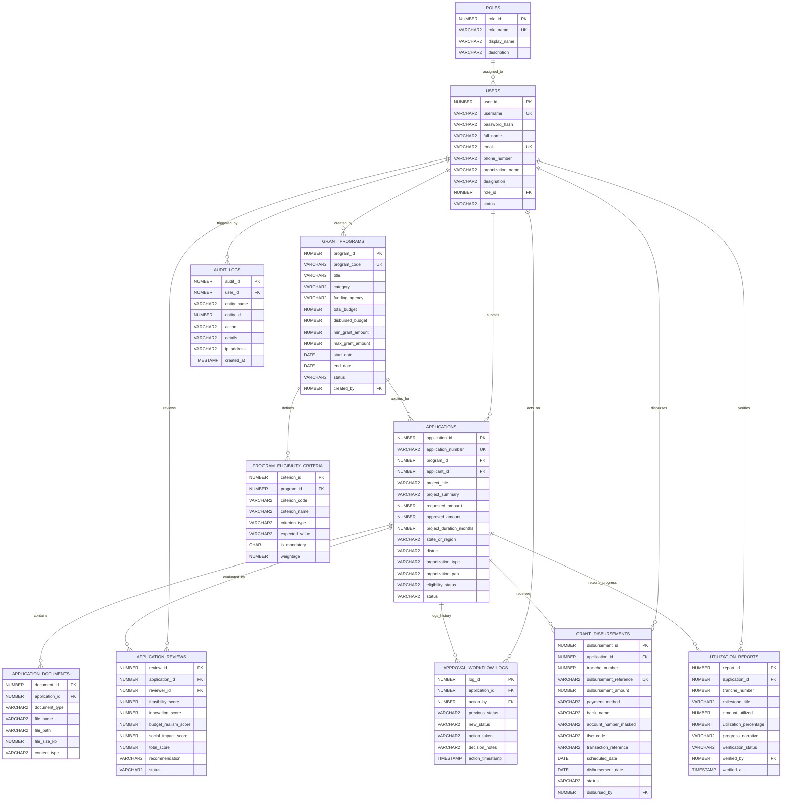

# J18 | Grants Management System - Entity Relationship (ER) Summary

## 1. Architectural Overview & 3NF Normalization
The database schema for the **Grants Management System (Government & Public Sector)** is designed strictly adhering to Third Normal Form (3NF):
- **1NF**: Atomic attributes, no repeating groups, unique primary keys across all tables.
- **2NF**: All non-key attributes fully functionally dependent on the primary key (no partial dependencies).
- **3NF**: All attributes functionally dependent only on the primary key (no transitive dependencies).

---

## 2. Entity Relationship Diagram (Mermaid)

---

## 3. Relationships & Multiplicities

| Parent Table | Child Table | Cardinality | Foreign Key Constraint | Cascade Behavior |
| :--- | :--- | :--- | :--- | :--- |
| `ROLES` | `USERS` | 1 to Many (`1:N`) | `fk_users_role` (`role_id`) | Restrict Delete |
| `USERS` | `GRANT_PROGRAMS` | 1 to Many (`1:N`) | `fk_program_creator` (`created_by`) | Restrict Delete |
| `GRANT_PROGRAMS` | `PROGRAM_ELIGIBILITY_CRITERIA` | 1 to Many (`1:N`) | `fk_crit_program` (`program_id`) | Cascade Delete |
| `GRANT_PROGRAMS` | `APPLICATIONS` | 1 to Many (`1:N`) | `fk_app_program` (`program_id`) | Restrict Delete |
| `USERS` | `APPLICATIONS` | 1 to Many (`1:N`) | `fk_app_applicant` (`applicant_id`) | Restrict Delete |
| `APPLICATIONS` | `APPLICATION_DOCUMENTS` | 1 to Many (`1:N`) | `fk_doc_application` (`application_id`) | Cascade Delete |
| `APPLICATIONS` | `APPLICATION_REVIEWS` | 1 to Many (`1:N`) | `fk_rev_application` (`application_id`) | Cascade Delete |
| `USERS` | `APPLICATION_REVIEWS` | 1 to Many (`1:N`) | `fk_rev_reviewer` (`reviewer_id`) | Restrict Delete |
| `APPLICATIONS` | `APPROVAL_WORKFLOW_LOGS` | 1 to Many (`1:N`) | `fk_wf_app` (`application_id`) | Cascade Delete |
| `USERS` | `APPROVAL_WORKFLOW_LOGS` | 1 to Many (`1:N`) | `fk_wf_actor` (`action_by`) | Restrict Delete |
| `APPLICATIONS` | `GRANT_DISBURSEMENTS` | 1 to Many (`1:N`) | `fk_disb_application` (`application_id`) | Restrict Delete |
| `USERS` | `GRANT_DISBURSEMENTS` | 1 to Many (`1:N`) | `fk_disb_officer` (`disbursed_by`) | Set Null / Restrict |
| `APPLICATIONS` | `UTILIZATION_REPORTS` | 1 to Many (`1:N`) | `fk_util_app` (`application_id`) | Cascade Delete |
| `USERS` | `UTILIZATION_REPORTS` | 1 to Many (`1:N`) | `fk_util_verifier` (`verified_by`) | Restrict Delete |
| `USERS` | `AUDIT_LOGS` | 1 to Many (`1:N`) | `fk_audit_user` (`user_id`) | Set Null |
