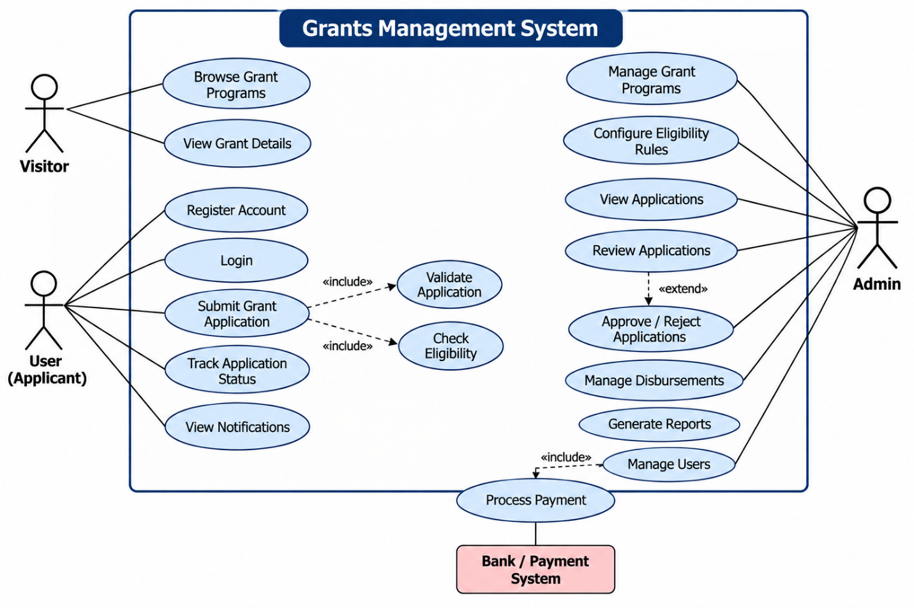
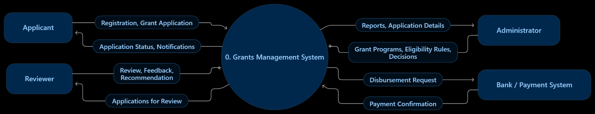
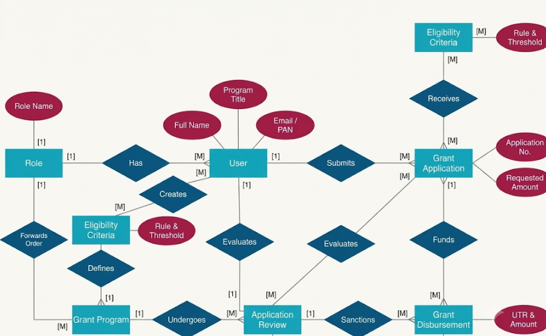

# SOFTWARE REQUIREMENTS SPECIFICATION (SRS)
## Grants Management System (GMS) | Project Code: J18
### Standard Academic Compliance: IEEE Std 830-1998

---

**DEPARTMENT OF COMPUTER APPLICATIONS / COMPUTER SCIENCE & ENGINEERING**  
**ABES ENGINEERING COLLEGE, GHAZIABAD**  
*(Affiliated to Dr. A.P.J. Abdul Kalam Technical University, Lucknow, Uttar Pradesh)*  

---

### SUBMISSION DETAILS

| Academic Parameter | Student & Project Record |
| :--- | :--- |
| **Project Title** | J18 \| Grants Management System |
| **Submitted By** | **Devansh Srivastava** |
| **University Roll No.** | **2500320140048** |
| **Degree & Branch** | Master of Computer Applications (MCA) |
| **Academic Year** | 2026 – 2027 |
| **Industry Track** | FSD Java (HCLTech EdTech Career Shaper Project) |
| **Under the Guidance of** | **Ms. Charshini Bandreddi** |
| **Project Status** | Capstone Full-Stack Implementation & System Specification |
| **Submission Date** | November 2026 |

---

### Document Revision & Approval History

| Version | Date | Description / Major Changes | Prepared By | Reviewed By |
| :--- | :--- | :--- | :--- | :--- |
| **0.1** | 15-Sep-2026 | Initial Draft, Domain Analysis & Scope Definition | Devansh Srivastava | Ms. Charshini Bandreddi |
| **0.2** | 10-Oct-2026 | Database Schema Normalization (3NF) & REST API Design | Devansh Srivastava | Project Review Committee |
| **1.0** | 19-Nov-2026 | Final Full-Stack IEEE 830 Baseline with Architectural Diagrams & RBAC | Devansh Srivastava | Project Guide & HOD |

> **Academic Guidance Note**: This document strictly adheres to the **IEEE Std 830-1998** recommended practice for Software Requirements Specifications. It defines the formal functional baselines, system interfaces, security policies, data constraints, and UML/ER analysis models for university evaluation.

---

## TABLE OF CONTENTS

- [1. Introduction](#1-introduction)
  - [1.1 Purpose](#11-purpose)
  - [1.2 Scope of the System](#12-scope-of-the-system)
  - [1.3 Definitions, Acronyms, and Abbreviations](#13-definitions-acronyms-and-abbreviations)
  - [1.4 References](#14-references)
  - [1.5 Document Overview](#15-document-overview)
- [2. Overall Description](#2-overall-description)
  - [2.1 Product Perspective](#21-product-perspective)
  - [2.2 User Classes and Characteristics](#22-user-classes-and-characteristics)
  - [2.3 Operating Environment](#23-operating-environment)
  - [2.4 Design and Implementation Constraints](#24-design-and-implementation-constraints)
  - [2.5 Assumptions and Dependencies](#25-assumptions-and-dependencies)
- [3. System Features and Functional Requirements](#3-system-features-and-functional-requirements)
  - [3.1 Module 1: Grant Program Setup and Configuration](#31-module-1-grant-program-setup-and-configuration)
  - [3.2 Module 2: Application Submission and Eligibility Check](#32-module-2-application-submission-and-eligibility-check)
  - [3.3 Module 3: Review and Approval Workflow](#33-module-3-review-and-approval-workflow)
  - [3.4 Module 4: Grant Disbursement and Reporting](#34-module-4-grant-disbursement-and-reporting)
- [4. External Interface Requirements](#4-external-interface-requirements)
  - [4.1 User Interfaces (UI)](#41-user-interfaces-ui)
  - [4.2 Hardware Interfaces](#42-hardware-interfaces)
  - [4.3 Software Interfaces](#43-software-interfaces)
  - [4.4 Communication Interfaces](#44-communication-interfaces)
- [5. Non-Functional Requirements (NFRs)](#5-non-functional-requirements-nfrs)
  - [5.1 Performance Requirements](#51-performance-requirements)
  - [5.2 Security and Access Governance Requirements](#52-security-and-access-governance-requirements)
  - [5.3 Reliability, Availability, and Robustness](#53-reliability-availability-and-robustness)
  - [5.4 Maintainability and Portability](#54-maintainability-and-portability)
- [6. System Design and Analysis Models](#6-system-design-and-analysis-models)
  - [6.1 Use Case Model and Actor Interaction](#61-use-case-model-and-actor-interaction)
  - [6.2 Data Flow Diagram (DFD Level 0 Context Diagram)](#62-data-flow-diagram-dfd-level-0-context-diagram)
  - [6.3 Entity-Relationship Model (3NF Relational Architecture)](#63-entity-relationship-model-3nf-relational-architecture)
- [7. Academic Review & Sign-Off](#7-academic-review--sign-off)

---

## 1. Introduction

### 1.1 Purpose
The purpose of this Software Requirements Specification (SRS) document is to provide a complete, rigorous, and unambiguous specification of the software requirements for the **Grants Management System (GMS)** (Project Code: **J18**). This document describes the functional behavior, external interface integrations, relational data models, non-functional targets, and architectural constraints required for the full-stack system built using Java, Spring Boot 3, Angular 14, and Oracle Database 21c XE. 

This document serves as the formal baseline agreement between the student developer, academic evaluators, university project guides, and stakeholders during the 2nd Year MCA curriculum at ABES Engineering College, Ghaziabad.

### 1.2 Scope of the System
In government, scientific, and public sector grant administration (e.g., Department of Science and Technology, Ministry of MSME, Ministry of Agriculture), traditional grant operations suffer from opaque tracking, manual paper-based eligibility verification errors, protracted evaluation committee turnaround times, and disconnected financial reconciliation of multi-tranche disbursements.

The **Grants Management System (GMS)** delivers an end-to-end digital lifecycle:
1. **Grant Program Setup & Configuration**: Enables Program Officers to design grant schemes with defined budgetary ceilings, application date windows, mandatory documentation checklists, and automated eligibility criteria.
2. **Application Submission & Automated Eligibility Check**: Provides an applicant portal for profile self-registration, scheme discovery, proposal submission, document uploading, and real-time algorithmic eligibility evaluation.
3. **Review & Approval Workflow**: Equips expert committee reviewers with a 4-dimensional scoring rubric (Feasibility, Innovation, Budget Realism, Social Impact: 0–100 scale) and provides Program Officers with sanction order issuing workflows.
4. **Grant Disbursement & Milestone Reporting**: Manages multi-tranche fund disbursements via Public Financial Management System (PFMS) / Direct Benefit Transfer (DBT) tracking, tracks applicant Utilization Certificates (UCs), and enforces audit logging.

#### In-Scope Boundaries:
- User authentication and strict Role-Based Access Control (RBAC) separating Applicant, Program Officer, Reviewer, and Admin portals.
- Program lifecycle management (`DRAFT`, `ACTIVE`, `UNDER_EVALUATION`, `CLOSED`).
- Rule engine executing numeric threshold, entity type, and financial turnover validations.
- Blind/assigned peer review scoring and sanction committee decision making.
- Milestone tranche disbursement scheduling, payment recording (UTR tracking), and UC verification.
- Audit logging of all critical governance actions and analytical reporting.

#### Out-of-Scope Boundaries:
- Physical bank clearance core-banking software (PFMS simulation via UTR transaction references is implemented).
- Direct biometrics hardware integration.

### 1.3 Definitions, Acronyms, and Abbreviations

| Category | Term / Acronym | Definition |
| :--- | :--- | :--- |
| **Standard** | **SRS** | Software Requirements Specification compliant with IEEE Std 830-1998. |
| **Architecture** | **REST** | Representational State Transfer stateless client-server architectural style using HTTP/JSON. |
| **Security** | **JWT / RBAC** | JSON Web Tokens for stateless authorization; Role-Based Access Control enforcing role boundaries. |
| **Security** | **BCrypt** | Adaptive password hashing function based on the Blowfish cipher. |
| **Domain** | **PFMS / DBT** | Public Financial Management System / Direct Benefit Transfer for government grant disbursements. |
| **Domain** | **UTR** | Unique Transaction Reference number issued by banking networks upon electronic fund transfers. |
| **Domain** | **UC** | Utilization Certificate submitted by grant recipients certifying approved fund utilization. |
| **Database** | **3NF** | Third Normal Form relational schema design eliminating transitive and partial dependencies. |
| **Database** | **JPA / ORM** | Java Persistence API / Object-Relational Mapping via Hibernate 6.x. |

### 1.4 References
1. **IEEE Std 830-1998**: *IEEE Recommended Practice for Software Requirements Specifications*, IEEE Computer Society, 1998.
2. **Sommerville, Ian**: *Software Engineering*, 10th Edition, Pearson Education, 2015.
3. **Pressman, Roger S.**: *Software Engineering: A Practitioner's Approach*, 8th Edition, McGraw-Hill, 2014.
4. **Spring Boot Reference Documentation**: Spring Boot 3.2.x, Pivotal Software / VMware Tanzu.
5. **Oracle Database 21c Database Reference**: Oracle Corporation, 2024.
6. **HCLTech EdTech Career Shaper**: *Project Development Document J18 - Grants Management System*, ABES Engineering College, 2026.

### 1.5 Document Overview
The remainder of this specification is structured as follows:
- **Section 2** describes the general factors that influence the product, user characteristics, and technical environment.
- **Section 3** specifies detailed functional requirements across all four core modules.
- **Section 4** outlines external hardware, software, user, and communication interfaces.
- **Section 5** sets measurable non-functional targets for performance, security, and reliability.
- **Section 6** presents the visual system analysis models (Use Case Diagram, DFD Level 0 Context Diagram, and 3NF Entity-Relationship Diagram).
- **Section 7** contains the academic verification and sign-off declarations.

---

## 2. Overall Description

### 2.1 Product Perspective
The Grants Management System is a multi-tier enterprise web application designed for sovereign and institutional grant delivery. It replaces scattered physical paperwork, uncoordinated email chains, and localized spreadsheets with an integrated, auditable web portal.

The application follows an enterprise 3-tier architecture:
- **Presentation Tier**: Angular 14 Single-Page Application (SPA) with dedicated, isolated role views.
- **Application Tier**: Spring Boot 3 RESTful microservices providing business logic, eligibility engine calculations, workflow controllers, and Spring Security 6 token authentication.
- **Data Tier**: Relational database (Oracle Database 21c XE / H2 in-memory compatibility) maintaining 3NF relational data integrity.

```
+-----------------------------------------------------------------------------------+
|                            PRESENTATION TIER (ANGULAR 14)                         |
|  [Applicant Portal]   [Program Officer Desk]   [Reviewer Portal]   [Admin Console]|
+-----------------------------------------------------------------------------------+
                                         │  (HTTPS / REST APIs / JSON)
                                         ▼
+-----------------------------------------------------------------------------------+
|                        APPLICATION LOGIC TIER (SPRING BOOT 3)                     |
|  [Security / JWT]  [Program Service]  [Eligibility Engine]  [Review / Sanction]  |
|  [Disbursement & PFMS Tranche Service]  [Utilization Tracker]  [Audit Logger]     |
+-----------------------------------------------------------------------------------+
                                         │  (Spring Data JPA / Hibernate)
                                         ▼
+-----------------------------------------------------------------------------------+
|                      DATABASE STORAGE TIER (ORACLE 21c XE / H2)                   |
|  ROLES | USERS | GRANT_PROGRAMS | ELIGIBILITY_RULES | APPLICATIONS | DOCUMENTS    |
|  APPLICATION_REVIEWS | DISBURSEMENTS | UTILIZATION_REPORTS | AUDIT_LOGS           |
+-----------------------------------------------------------------------------------+
```

### 2.2 User Classes and Characteristics
The system defines four distinct actor classes with strictly partitioned permissions:

| User Class | Technical Background | Role Responsibilities & Access Boundaries |
| :--- | :--- | :--- |
| **Grant Applicant** (`ROLE_APPLICANT`) | General Web User | Browses active schemes; self-registers profile; submits grant proposals; uploads compliance documents; tracks live application status; submits milestone utilization reports (UCs). Access strictly limited to self-owned records. |
| **Program Officer** (`ROLE_PROGRAM_OFFICER`) | Public Administration / Domain Expert | Configures grant programs and budget allocations; defines automated eligibility criteria; initiates automated eligibility verification; assigns proposals to reviewers; issues sanction orders; schedules and releases PFMS disbursements; verifies milestone UCs. |
| **Committee Reviewer** (`ROLE_REVIEWER`) | Technical / Scientific Evaluator | Accesses assigned proposal queue; inspects applicant proposal narratives and financial requests; scores applications across 4 standardized rubric dimensions (0–100 scale); submits recommendations. |
| **System Administrator** (`ROLE_ADMIN`) | System Engineer / Database Administrator | Full governance privileges; monitors macro platform KPIs; creates and manages user accounts and role assignments; inspects immutable security audit trails. |

### 2.3 Operating Environment
- **Client Platforms**: Google Chrome (v110+), Mozilla Firefox (v108+), Microsoft Edge (v110+), Apple Safari (v16+). Minimum display resolution: 1366 × 768 pixels.
- **Server Platform**: Windows 10/11 64-bit or Linux (Ubuntu 22.04 LTS / RHEL 9).
- **Backend Runtime**: Java Development Kit (JDK 17 LTS), Spring Boot 3.2.x framework, embedded Apache Tomcat 10.
- **Database Engine**: Oracle Database 21c XE (Express Edition) / H2 Relational Engine (embedded driver for testing).
- **Frontend Runtime**: Node.js 18 LTS with npm 9+, Angular CLI 14.

### 2.4 Design and Implementation Constraints
1. **Academic Technology Stack**: Mandated adherence to Java, Spring Boot 3, Angular 14, and Oracle 21c XE.
2. **Relational Normalization**: Schema must be normalized to Third Normal Form (3NF) to eliminate data redundancy and anomalies.
3. **Security Standards**: Passwords must never be stored in plain text; BCrypt cryptographic hashing with salt factor 10 is required. Stateless JWT tokens must secure all REST endpoints.
4. **Role Separation**: Zero privilege bleeding between portals; Applicants cannot access review queues or disbursement buttons, and Reviewers cannot alter program budgets.

### 2.5 Assumptions and Dependencies
- **Assumptions**: Users possess an active internet connection (minimum 2 Mbps); client clocks are synchronized via NTP for token validity.
- **Dependencies**: Java 17 LTS runtime, modern ECMAScript 6+ capable web browser.

---

## 3. System Features and Functional Requirements

### 3.1 Module 1: Grant Program Setup and Configuration

#### FR-1.1: Program Creation and Budgeting
- **Description**: The Program Officer shall create a new grant program with official metadata.
- **Inputs**: Program Code (e.g., `DST-SEED-2026`), Title, Sponsoring Agency, Category (`INNOVATION`, `AGRICULTURE`, `HEALTHCARE`, `WOMEN_ENTREPRENEURSHIP`), Total Allocated Budget (INR), Grant Range (Min/Max Amount), and Active Application Window (Start Date, End Date).
- **Validation**: Total Budget > 0; Max Grant Amount <= Total Budget; End Date > Start Date.
- **Priority**: High.

#### FR-1.2: Eligibility Rule Configuration
- **Description**: The Program Officer shall attach multiple parametric eligibility criteria to each program.
- **Inputs**: Criterion Name, Rule Operator (`GREATER_THAN_EQUAL`, `LESS_THAN_EQUAL`, `EQUALS`, `IN_LIST`), Threshold Value (e.g., Minimum 3 Years Operating Age, Maximum ₹10 Crore Annual Turnover), Mandatory Flag (`TRUE`/`FALSE`), Weightage (0–100).
- **Priority**: High.

#### FR-1.3: Program Lifecycle State Machine
- **Description**: The system shall enforce a valid state machine for program lifecycle transitions: `DRAFT` ➔ `ACTIVE` ➔ `UNDER_EVALUATION` ➔ `CLOSED`.
- **Priority**: Medium.

---

### 3.2 Module 2: Application Submission and Eligibility Check

#### FR-2.1: Applicant Self-Registration and Authentication
- **Description**: Prospective grant applicants shall self-register with organization credentials and authenticate securely.
- **Inputs**: Full Name, Email Address, Password, Phone Number, Organization Name, Organization Type (`STARTUP`, `NGO`, `ACADEMIC_INSTITUTE`, `ENTERPRISE`), PAN, GSTIN.
- **Output**: Encrypted account record with assigned `ROLE_APPLICANT` role and issuance of JWT session token upon sign-in.
- **Priority**: High.

#### FR-2.2: Proposal Submission Form
- **Description**: Authenticated applicants shall select an `ACTIVE` grant program and submit a detailed grant proposal.
- **Inputs**: Project Title, Executive Summary, Requested Grant Amount (INR), Project Duration (Months), Operating Age (Years), Annual Turnover (INR), Number of Target Beneficiaries, Bank Account Number, Bank IFSC Code.
- **Validation**: Requested Amount within Program Min/Max range; Project Duration >= 1 month; Valid 10-character PAN and 15-character GSTIN.
- **Priority**: High.

#### FR-2.3: Automated Algorithmic Eligibility Evaluation
- **Description**: Upon proposal submission, the system eligibility engine shall automatically evaluate applicant metrics against the program's configured rules.
- **Processing Logic**:
  - Compares Applicant Operating Age against Minimum Required Age.
  - Compares Applicant Annual Turnover against Maximum Allowed Turnover Ceiling.
  - Matches Applicant Entity Type against Allowed Entity Types.
  - Checks presence of mandatory compliance credentials.
- **Output**: Automatically marks status as `AUTO_ELIGIBLE` or `AUTO_INELIGIBLE` with descriptive audit failure remarks.
- **Priority**: High.

#### FR-2.4: Real-Time Application Tracking
- **Description**: Applicants shall monitor the current lifecycle state of their submissions (`SUBMITTED` ➔ `AUTO_ELIGIBLE` / `AUTO_INELIGIBLE` ➔ `UNDER_REVIEW` ➔ `APPROVED` / `REJECTED` ➔ `DISBURSED`).
- **Priority**: High.

---

### 3.3 Module 3: Review and Approval Workflow

#### FR-3.1: Reviewer Assignment
- **Description**: The Program Officer shall assign eligible applications to technical peer reviewers from the evaluation panel.
- **Priority**: High.

#### FR-3.2: 4-Dimensional Rubric Scorecard
- **Description**: Assigned Reviewers shall inspect the proposal details and submit standardized scores across four evaluation dimensions:
  1. **Technical Feasibility** (0 to 25 points)
  2. **Innovation & Novelty** (0 to 25 points)
  3. **Budget Realism & Financial Viability** (0 to 25 points)
  4. **Social & Economic Impact** (0 to 25 points)
- **Output**: Calculated Composite Score (0 to 100), Recommendation (`STRONGLY_RECOMMENDED`, `RECOMMENDED`, `REVISE_BUDGET`, `REJECT`), and Qualitative Remarks.
- **Priority**: High.

#### FR-3.3: Sanction Committee Decision and Order Generation
- **Description**: The Program Officer shall review all reviewer scorecards and issue a formal sanction decision (`APPROVED` or `REJECTED`). For approved proposals, the Officer specifies the Final Sanctioned Amount and Sanction Order Number.
- **Priority**: High.

#### FR-3.4: Workflow State Transition & Audit Logging
- **Description**: Every state transition shall generate an immutable workflow log recording Previous Status, New Status, Timestamp, Actor ID, and Action Remarks.
- **Priority**: High.

---

### 3.4 Module 4: Grant Disbursement and Reporting

#### FR-4.1: Multi-Tranche Disbursement Scheduling
- **Description**: For approved applications, the Program Officer shall schedule multi-tranche disbursements specifying Tranche Number, Scheduled Date, Disbursement Amount, and Beneficiary Bank Account.
- **Validation**: Sum of all scheduled tranche amounts <= Final Sanctioned Grant Amount.
- **Priority**: High.

#### FR-4.2: Fund Release Execution (PFMS / DBT Tracking)
- **Description**: The Program Officer executes scheduled tranches, generating a simulated Public Financial Management System (PFMS) transaction with a Unique Transaction Reference (UTR) number and updating the Program's Disbursed Amount counter.
- **Priority**: High.

#### FR-4.3: Milestone Utilization Certificate (UC) Submission
- **Description**: Prior to the release of subsequent tranches, the Grant Applicant shall submit a Milestone Utilization Report detailing Expenditure Incurred (INR), Milestone Progress Description, Project Completion Percentage (0–100%), and upload an audited Utilization Certificate (UC).
- **Priority**: High.

#### FR-4.4: Officer UC Verification & Audit
- **Description**: The Program Officer shall inspect submitted UCs and record verification status (`VERIFIED_SATISFACTORY`, `REQUIRES_CLARIFICATION`, `REJECTED`) before releasing subsequent tranches.
- **Priority**: High.

#### FR-4.5: Executive Analytics Dashboard
- **Description**: The system shall aggregate and display real-time governance metrics: Total Schemes, Total Allocated Budget, Total Sanctioned Funds, Total Disbursed Capital, Application Distribution by Status, and Sectoral Budget Allocations.
- **Priority**: Medium.

---

## 4. External Interface Requirements

### 4.1 User Interfaces (UI)
The frontend is implemented as a responsive Single-Page Application (SPA) structured around four role-isolated portals:
1. **Public / Authentication View**: Landing page, active program catalog, sign-in dialog, and applicant self-registration modal.
2. **Grant Applicant Portal**: Application drafting wizard, live eligibility feedback banner, submission tracker, and milestone UC submission form.
3. **Program Officer Desk**: Scheme creation suite, eligibility rule configurator, reviewer assignment queue, sanction decision console, and tranche release manager.
4. **Reviewer Evaluation Portal**: Assigned proposal queue, proposal viewer, interactive 4-slider rubric scoring panel, and recommendation submission dialog.
5. **System Administrator Console**: System KPI cards, user management table with role assignment modal, and security audit log explorer.

### 4.2 Hardware Interfaces
- **Server Tier**: Standard x86-64 server or cloud virtual machine with minimum 4 CPU cores, 8 GB RAM (16 GB recommended for Oracle XE + JVM), and 25 GB SSD storage.
- **Client Tier**: Standard PC, laptop, or tablet with keyboard, mouse, and 1366 × 768 or higher display.

### 4.3 Software Interfaces
- **Operating System**: Microsoft Windows 10/11 64-bit or Linux (Ubuntu 22.04 LTS).
- **Backend Framework**: Spring Boot 3.2.3, Spring Security 6, Spring Data JPA, Hibernate 6.
- **Database Engine**: Oracle Database 21c Express Edition (XE) / H2 Relational Engine.
- **Frontend Stack**: Angular 14, TypeScript 4.8+, HTML5, CSS3 / Bootstrap.
- **Security Utilities**: JJWT (Java JWT) library, BCryptPasswordEncoder.

### 4.4 Communication Interfaces
- **Web Communication Protocol**: HTTPS (Hypertext Transfer Protocol Secure over Port 443 with TLS 1.3 encryption).
- **Data Interchange Format**: RESTful JSON (`application/json;charset=UTF-8`).
- **Authorization Header**: Bearer token schema (`Authorization: Bearer <JWT_TOKEN>`).

---

## 5. Non-Functional Requirements (NFRs)

### 5.1 Performance Requirements
- **NFR-1.1 Response Latency**: Core REST API endpoints shall respond in less than 300 ms under a concurrent load of 50 active users.
- **NFR-1.2 Eligibility Engine Execution**: Algorithmic eligibility checking against 10 configured rules shall complete in under 50 ms per submission.
- **NFR-1.3 Database Query Latency**: Indexed primary and foreign key queries shall execute within 20 ms.

### 5.2 Security and Access Governance Requirements
- **NFR-2.1 Password Cryptography**: Passwords shall be salted and hashed using BCrypt (cost factor 10). Plain-text passwords shall never be persisted or logged.
- **NFR-2.2 Stateless Token Governance**: Sessions shall be managed via HMAC-SHA256 signed JSON Web Tokens (JWT) containing subject, issued-at, and role claims with a 24-hour expiration horizon.
- **NFR-2.3 Role-Based Access Control (RBAC)**: All endpoints shall enforce `@PreAuthorize("hasRole('...')")` annotations to prevent privilege escalation.
- **NFR-2.4 SQL Injection Neutralization**: All database access shall utilize Spring Data JPA parameterized queries and prepared statements.
- **NFR-2.5 Audit Trail Integrity**: Security-sensitive actions (approvals, disbursements, user modifications) shall be permanently recorded in an append-only `audit_logs` table.

### 5.3 Reliability, Availability, and Robustness
- **NFR-3.1 System Availability**: The system shall achieve 99.5% uptime during operational evaluation hours.
- **NFR-3.2 Transactional Integrity**: All multi-table mutations (e.g., sanctioning an application, scheduling tranches, deducting budgets) shall be annotated with `@Transactional` to guarantee ACID properties.
- **NFR-3.3 Graceful Error Handling**: API exceptions shall return standardized JSON error objects containing timestamp, HTTP status, and user-friendly error messages without exposing stack traces.

### 5.4 Maintainability and Portability
- **NFR-4.1 Modular Architecture**: Clean separation of concerns across Controller, Service, Repository, and Model layers.
- **NFR-4.2 Database Agnostic Design**: Standard ANSI-SQL DDL and JPA entities enable seamless portability between Oracle 21c XE, PostgreSQL, and H2.
- **NFR-4.3 Cross-Browser Compliance**: Fully functional on Chrome, Edge, Firefox, and Safari across desktop and mobile viewports.

---

## 6. System Design and Analysis Models

### 6.1 Use Case Model and Actor Interaction

The Use Case Diagram models the system functional boundaries and actor interactions across the grant management lifecycle:



#### Use Case Actor Descriptions:
1. **Visitor**:
   - `Browse Grant Programs`: Views public list of available schemes.
   - `View Grant Details`: Inspects scheme objectives, funding guidelines, and eligibility rules.
2. **User (Applicant)**:
   - `Register Account`: Self-onboards organization profile.
   - `Login`: Authenticates with email and password to receive JWT token.
   - `Submit Grant Application`: Fills proposal form (`<<include>>` `Validate Application` and `<<include>>` `Check Eligibility`).
   - `Track Application Status`: Views stage-by-stage evaluation progress.
   - `View Notifications`: Receives updates on status changes and sanctions.
3. **Admin / Program Officer**:
   - `Manage Grant Programs`: Creates, edits, and manages scheme budgets.
   - `Configure Eligibility Rules`: Sets numeric thresholds and qualifying criteria.
   - `View Applications`: Filters and searches submissions.
   - `Review Applications`: Evaluates proposal contents (`<<extend>>` `Approve / Reject Applications`).
   - `Manage Disbursements`: Authorizes tranche releases (`<<include>>` `Process Payment`).
   - `Generate Reports`: Downloads and visualizes grant utilization analytics.
   - `Manage Users`: Onboards, modifies, and deactivates platform users.
4. **Bank / Payment System (PFMS)**:
   - `Process Payment`: Executes electronic fund transfer and returns UTR reference.

---

### 6.2 Data Flow Diagram (DFD Level 0 Context Diagram)

The Level 0 Context Diagram defines the information boundaries between external entities and the core Grants Management System:



#### Context Data Flows:
- **Applicant ➔ GMS**: Submits Registration data and Grant Application proposals with financial requirements.
- **GMS ➔ Applicant**: Returns Application Status, eligibility evaluation outcomes, and sanction notifications.
- **Reviewer ➔ GMS**: Submits Rubric Evaluations, numerical scores (0–100), and recommendation notes.
- **GMS ➔ Reviewer**: Dispatches assigned Applications for peer review.
- **Administrator / Officer ➔ GMS**: Configures Grant Programs, specifies Eligibility Rules, assigns reviewers, and enters sanction Decisions.
- **GMS ➔ Administrator / Officer**: Provides analytical Reports, application dossiers, and audit metrics.
- **GMS ➔ Bank / Payment System**: Transmits authorized Disbursement Requests with beneficiary account and IFSC details.
- **Bank / Payment System ➔ GMS**: Emits electronic Payment Confirmations containing Unique Transaction Reference (UTR) numbers.

---

### 6.3 Entity-Relationship Model (3NF Relational Architecture)

The Entity-Relationship Diagram represents the normalized Third Normal Form (3NF) relational database structure deployed on Oracle Database 21c XE:



#### Relational Entities and Cardinalities:
1. **`ROLES` to `USERS` (1 to Many)**:
   - Each Role (`ROLE_ADMIN`, `ROLE_PROGRAM_OFFICER`, `ROLE_REVIEWER`, `ROLE_APPLICANT`) is associated with multiple Users.
2. **`USERS` to `GRANT_APPLICATIONS` (1 to Many)**:
   - A registered Applicant user submits zero, one, or multiple grant applications.
3. **`GRANT_PROGRAMS` to `ELIGIBILITY_CRITERIA` (1 to Many)**:
   - A Program Officer defines one or more eligibility criteria for a grant program.
4. **`GRANT_PROGRAMS` to `GRANT_APPLICATIONS` (1 to Many)**:
   - A grant program receives multiple applicant submissions.
5. **`GRANT_APPLICATIONS` to `APPLICATION_REVIEWS` (1 to Many)**:
   - Each application is assigned to one or more peer reviewers who submit evaluation scorecards.
6. **`USERS` (Reviewer) to `APPLICATION_REVIEWS` (1 to Many)**:
   - A reviewer evaluates multiple assigned proposals.
7. **`GRANT_APPLICATIONS` to `GRANT_DISBURSEMENTS` (1 to Many)**:
   - An approved application is funded across one or multiple scheduled disbursement tranches.
8. **`GRANT_DISBURSEMENTS` to `UTILIZATION_REPORTS` (1 to 1)**:
   - Each disbursed tranche requires a corresponding milestone utilization report certifying proper expenditure.

---

## 7. Academic Review & Sign-Off

This Software Requirements Specification document for the **Grants Management System (Project J18)** has been thoroughly reviewed and validated against academic and industry benchmarks:

```
+------------------------------------+------------------------------------+
| EVALUATION COMMITTEE               | SIGNATURE & DATE                   |
+------------------------------------+------------------------------------+
| Project Guide:                     |                                    |
| Ms. Charshini Bandreddi            | Signature: ______________________  |
| Assistant Professor, MCA           | Date:      ______________________  |
| ABES Engineering College           |                                    |
+------------------------------------+------------------------------------+
| Internal Examiner:                 |                                    |
| Department of Computer Applications| Signature: ______________________  |
| ABES Engineering College           | Date:      ______________________  |
+------------------------------------+------------------------------------+
| Head of Department (HOD):          |                                    |
| Department of Computer Applications| Signature: ______________________  |
| ABES Engineering College           | Date:      ______________________  |
+------------------------------------+------------------------------------+
```

*End of Software Requirements Specification (SRS) Document.*
